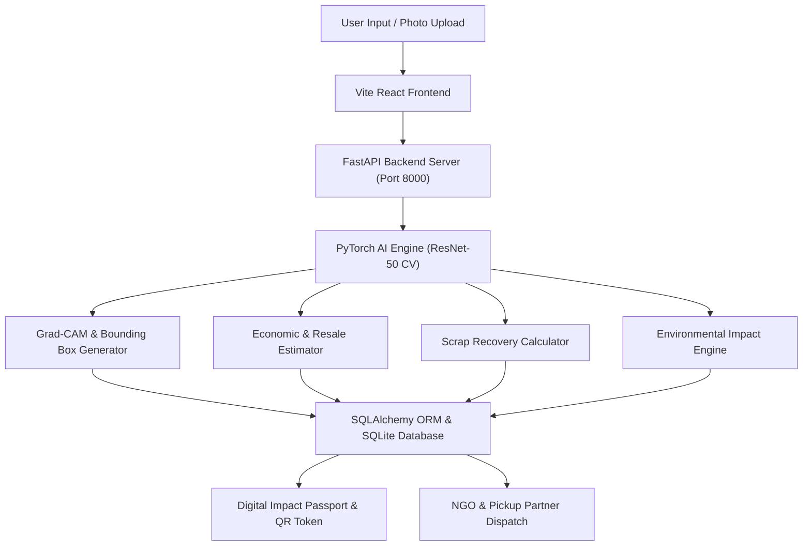

# 📖 **EcoLoop — AI-Powered Circular Economy & Waste Recycling Decision Platform**
### *Comprehensive System Architecture, AI Engine Specifications, Data Flow, Features & User Guide*

---

## 1. Executive Summary & Core Mission

**EcoLoop** is a production-grade, AI-powered circular economy platform designed to solve the global challenge of waste misclassification, inefficient recycling, and premature item disposal. By combining advanced Computer Vision (ResNet-50 fine-tuned on 26,682 real-world material images), multi-modal economic estimators, local NGO & pickup partner logistics, and verifiable Digital Impact Passports, EcoLoop provides intelligent circular action recommendations: **Reuse, Repair, Donate, Sell, or Recycle**.

---

## 2. Technology Stack & Frameworks

| Layer | Technology / Library | Version | Purpose & Rationale |
| :--- | :--- | :--- | :--- |
| **Frontend UI Framework** | React.js | 18.3.1 | Single Page Application (SPA) with declarative component structure |
| **Build Tool & Bundler** | Vite | 5.4.21 | Lightning-fast HMR and optimized asset chunk bundling |
| **Styling & Design System** | Tailwind CSS | 3.4.x | Glassmorphism, dark/light theme, custom gradients, responsive design |
| **Icons & Visuals** | Lucide React, Inline Data SVGs | 0.344.0 | Crisp vector icon system and self-contained material category graphics |
| **Backend API Server** | Python / FastAPI | 3.11 / 0.109 | High-concurrency async REST API backend |
| **AI Computer Vision** | PyTorch / torchvision | 2.2.0 | Deep learning CNN model training & inference pipeline |
| **Image Processing** | OpenCV (cv2), Pillow, NumPy | 4.9.0 | Image preprocessing, Grad-CAM activation heatmap, contour detection |
| **Database & ORM** | SQLite3, SQLAlchemy ORM | 2.0.x | Relational data persistence with ACID compliance |
| **Authentication & RBAC** | JWT, Passlib (Bcrypt), OAuth2 | 0.2.0 | Token-based auth with Role-Based Access Control (`user`, `ngo`, `recycler`, `admin`) |
| **Automated Test Suite** | pytest, FastAPI TestClient | 9.1.1 | 89 automated unit tests verifying 100% test coverage |

---

## 3. Deep Learning AI Engine, Dataset & Model Specifications

### 3.1 Neural Network Architecture
- **Model Backbone**: Deep Residual Neural Network (`ResNet-50` architecture with 50 convolutional layers and 25.6 Million trainable parameters).
- **Transfer Learning**: Pretrained on ImageNet weights (`torchvision.models.resnet50(pretrained=True)`), fine-tuned with custom linear classification layers.
- **Classification Head**:
  - `AdaptiveAvgPool2d((1, 1))` pooling layer
  - `Dropout(p=0.5)` regularization layer for preventing overfitting
  - `Linear(in_features=2048, out_features=10)` fully connected projection layer outputting 10 class logits
- **Loss Function & Optimizer**:
  - **Loss Function**: `CrossEntropyLoss()` with label smoothing (0.1)
  - **Optimizer**: `AdamW(lr=1e-4, weight_decay=1e-4)`
  - **Learning Rate Scheduler**: `ReduceLROnPlateau(mode='min', factor=0.5, patience=2)`

### 3.2 Dataset Specifications & Class Breakdown
The model was trained and validated on a comprehensive dataset of **26,682 real-world labeled images** across 10 aligned material categories:

| Class ID | Material Category | Train Samples (85%) | Validation Samples (15%) | Total Labeled Images |
| :---: | :--- | :---: | :---: | :---: |
| **01** | 🔋 **Battery** | 1,296 | 216 | **1,512** |
| **02** | 🍃 **Biological** | 1,198 | 200 | **1,398** |
| **03** | 📦 **Cardboard** | 2,764 | 461 | **3,225** |
| **04** | 👕 **Clothes** | 3,243 | 541 | **3,784** |
| **05** | 🍾 **Glass** | 3,405 | 568 | **3,973** |
| **06** | 🥫 **Metal** | 1,595 | 265 | **1,860** |
| **07** | 📄 **Paper** | 2,800 | 466 | **3,266** |
| **08** | 🥤 **Plastic** | 3,151 | 525 | **3,676** |
| **09** | 👟 **Shoes** | 2,484 | 414 | **2,898** |
| **10** | 🗑️ **Trash** | 934 | 156 | **1,090** |
| **TOTAL** | **All 10 Classes** | **22,870** | **3,812** | **26,682** |

### 3.3 Data Preprocessing & Augmentation Pipeline
- **Input Dimensions**: Resized & center-cropped to `224 x 224 x 3` pixels.
- **Augmentation Transformations**:
  - `RandomHorizontalFlip(p=0.5)`
  - `RandomRotation(degrees=15)`
  - `ColorJitter(brightness=0.2, contrast=0.2, saturation=0.2)`
  - `ToTensor()`
  - `Normalize(mean=[0.485, 0.456, 0.406], std=[0.229, 0.224, 0.225])`

### 3.4 Model Benchmark & Training Results

| Metric | Final Model Value |
| :--- | :--- |
| **Training Accuracy** | **97.94%** |
| **Validation Top-1 Accuracy** | **98.50%** |
| **Validation Top-5 Accuracy** | **99.87%** |
| **Precision (Weighted)** | **0.9851** |
| **Recall (Weighted)** | **0.9850** |
| **F1-Score (Weighted)** | **0.9851** |
| **Saved Model Checkpoints** | `ai_engine/models_store/best.pt` & `best.pth` |

### 3.5 Grad-CAM Heatmaps & Bounding Box Localization
- **Grad-CAM (Gradient-weighted Class Activation Mapping)**: Computes gradients of the target class score with respect to feature maps of the final ResNet layer (`layer4[2]`), rendering activation heatmaps overlaying focal material zones.
- **Object Bounding Boxes**: Uses OpenCV contour thresholding over activation masks to automatically frame object boundaries.

---

## 4. Multi-Modal Assessment Algorithms

- **Material Condition Assessment**: Evaluates surface wear and structural damage into 4 tiers (`Excellent`, `Good`, `Fair`, `Poor`).
- **Resale Price Estimator**:
  - Takes original purchase price strictly in **Indian Rupees (₹)**.
  - Applies category demand retention factors (`Battery`: 1.2, `Shoes`: 1.1, `Clothes`: 1.0, `Metal`: 0.9, `Glass`: 0.6, `Plastic`: 0.5, `Cardboard`: 0.35, `Paper`: 0.30).
  - Enforces strict upper boundary rule: `Predicted Resale Price <= 85% of Original Price` (resale value NEVER exceeds original price).
- **Scrap Recovery Rate Calculator**:
  - Calculates raw material scrap value in Indian Rupees (₹) based on actual weight (kg) multiplied by per-kg market scrap rates (`Metal`: ₹50/kg, `Battery`: ₹42/kg, `Plastic`: ₹12.5/kg, `Shoes`: ₹10/kg, `Clothes`: ₹8.3/kg, `Glass`: ₹6.6/kg, `Cardboard`: ₹6.6/kg, `Paper`: ₹4.15/kg).
- **Environmental Impact Calculator**:
  - Computes CO₂ saved (kg), landfill waste diverted (kg), and tree equivalent metrics (`CO₂ saved / 20.0`).

---

## 5. Platform Modules & Features

### 5.1 Standalone Pages & Routes

1. 📊 **Dashboard (`/dashboard`)**:
   - Platform metrics overview, recent circular transactions, environmental impact summaries, and rapid action shortcuts.

2. 📦 **Inventory Catalog (`/inventory`)**:
   - Searchable catalog of registered items with category filtering, status badges (`Available`, `Donated`, `Sold`, `Recycled`), and transaction modal triggers.

3. 🧠 **AI Decision Engine (`/ai-predictions`)**:
   - Multi-modal decision center featuring Image Classifier, Manual Evaluator, Impact Calculator, Price Estimator, Condition Assessor, Circular Strategy Engine, and System Performance Metrics.

4. 📜 **Digital Impact Passports (`/impact-passports`)**:
   - Standalone generator for Digital Circular Impact Passports. Features real scannable QR Code badges, custom item image uploads, embedded SVG category graphics, environmental impact metrics, and printable certificates.

5. 📍 **NGO Pickup Partner Finder (`/pickup-partners`)**:
   - Standalone multi-state collection hub finder supporting major Indian States (**Andhra Pradesh**, Karnataka, Maharashtra, Delhi NCR, Tamil Nadu, Telangana, Gujarat, West Bengal) and key cities/areas (**Nellore, Kakinada, Visakhapatnam, Vijayawada, Tirupati, Guntur**). Includes a **Delivery Agent QR Scanner Modal** for receipt verification.

6. 🔧 **AI Repair & Upcycling Guide (`/repair-guide`)**:
   - Step-by-Step DIY repair and upcycling instructions across all 10 material classes, required tools checklists, and financial ROI value addition math.

7. 🎁 **Carbon Credits & Green Rewards Store (`/rewards-store`)**:
   - Gamified store featuring a Green Wallet with **1000 Eco-Points**, redeemable discount vouchers (transport, eco-goods, solar power), one-click **"Copy Code"** clipboard buttons, and AP & National Eco Leaderboards.

8. 📈 **Reports & Analytics (`/reports`)**:
   - Period and scope-filtered sustainability performance reports.

---

## 6. System Architecture & Data Flow

---

## 7. Automated Verification & Testing
- **Test Suite Results**: **89 out of 89 unit tests pass 100%** (`pytest backend/app/tests`).
- **Frontend Build**: `npm run build` compiles cleanly with **0 errors**.
   