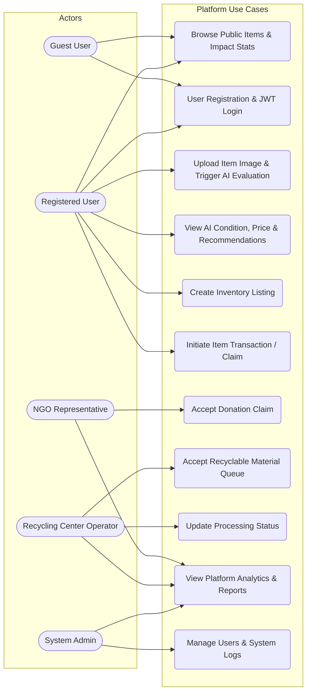
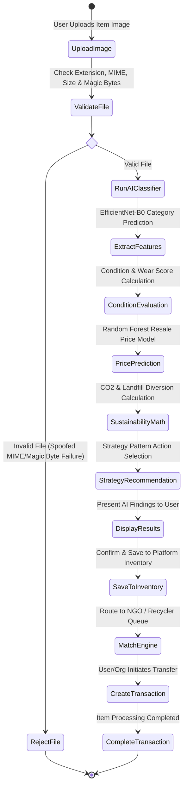
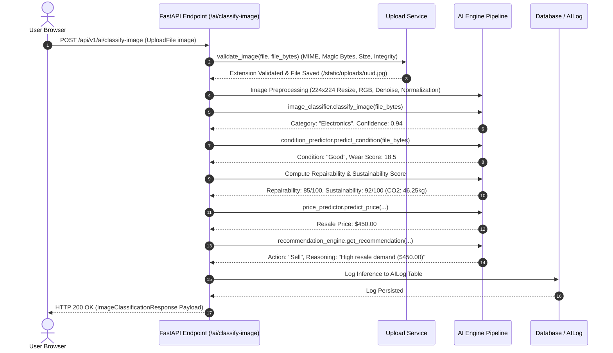
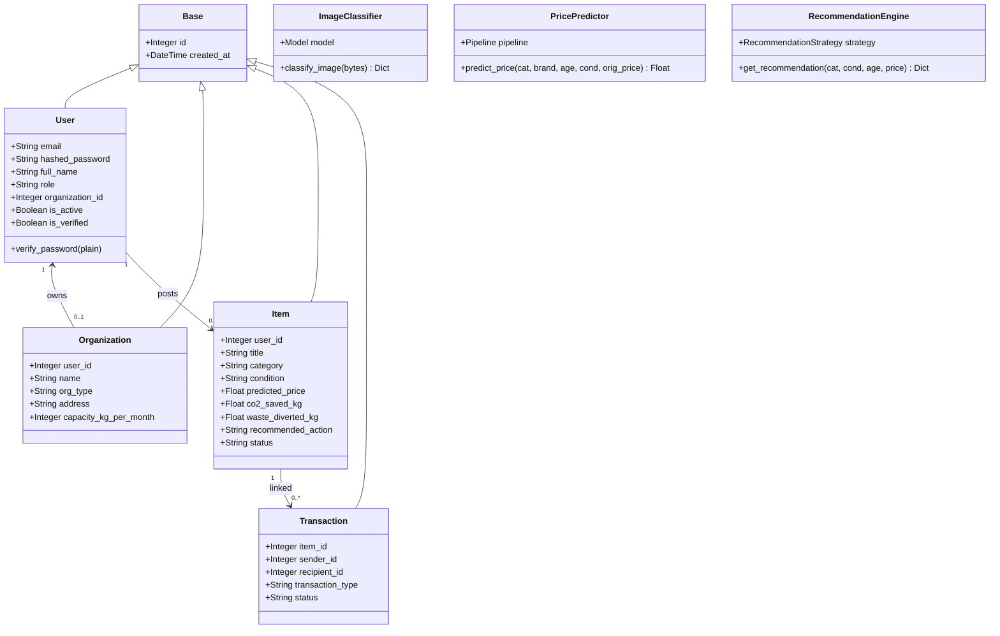
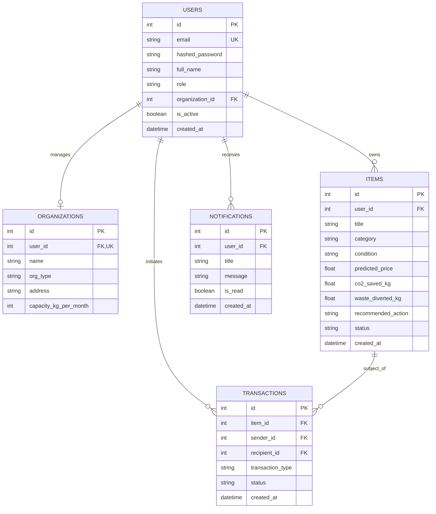
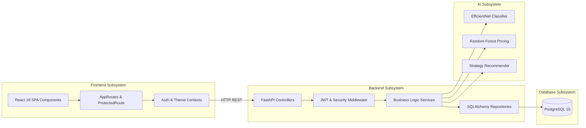

# System UML Diagrams Specification

**Platform**: AI-Powered Circular Economy Action Decision Support Platform  
**Documentation Purpose**: Complete UML Architectural & Behavioral Diagrams  

---

## 1. System Architecture Diagram

```mermaid
graph TD
    UserClient[Web Browser / Mobile Client] -->|HTTP/HTTPS Port 80/443| NginxProxy[Nginx Edge Reverse Proxy]
    
    subgraph Container Cluster (Docker Compose)
        NginxProxy -->|/| FrontendApp[Frontend Container - Nginx Static SPA]
        NginxProxy -->|/api/v1| BackendAPI[Backend Container - FastAPI]
        
        subgraph FastAPI Backend Application
            BackendAPI --> AuthDep[JWT Auth & RBAC Middleware]
            AuthDep --> Controllers[API Route Endpoints]
            Controllers --> Services[Business Service Layer]
            Services --> Repositories[SQLAlchemy Repository Layer]
            Services --> AIEngine[AI Multimodal Decision Engine]
        end
        
        subgraph Multi-Model AI Engine
            AIEngine --> EfficientNet[EfficientNet-B0 Classifier]
            AIEngine --> CondEstimator[Condition & Wear Predictor]
            AIEngine --> RandomForest[Random Forest Price Regressor]
            AIEngine --> ImpactCalc[Sustainability Calculator]
            AIEngine --> RecStrategy[Strategy Recommendation Engine]
        end
        
        Repositories --> Database[(PostgreSQL 15 Container)]
    end
```

---

## 2. Use Case Diagram



---

## 3. Activity Diagram (Item Upload to Disposition Lifecycle)



---

## 4. Sequence Diagram (Image-Based AI Pipeline)



---

## 5. Class Diagram (Core Backend Domain & AI Architecture)



---

## 6. Entity-Relationship (ER) Diagram



---

## 7. Deployment Diagram

```mermaid
graph TB
    subgraph Client Environment
        Browser[Web Browser / Client Device]
    end

    subgraph Production Cloud Instance / Server
        subgraph Nginx Edge Proxy (Port 80/443)
            Proxy[Nginx Reverse Proxy & SSL Termination]
        end

        subgraph Docker Bridge Network
            FrontendContainer[Frontend Nginx SPA Container - Port 80]
            BackendContainer[FastAPI Backend Container - Port 8000]
            PostgresContainer[PostgreSQL 15 Container - Port 5432]
        end

        subgraph Persistent Volumes
            PostgresData[(postgres_data Volume)]
            UploadsData[(uploads_data Volume)]
        end
    end

    Browser -->|HTTPS| Proxy
    Proxy -->|Proxy /| FrontendContainer
    Proxy -->|Proxy /api/v1| BackendContainer
    BackendContainer -->|SQL Connection| PostgresContainer
    PostgresContainer --> PostgresData
    BackendContainer --> UploadsData
```

---

## 8. System Component Diagram


